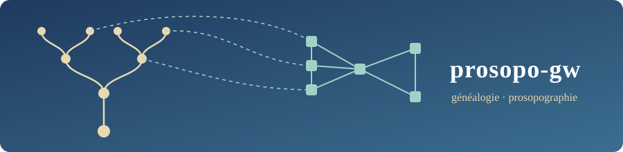
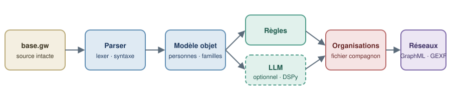

<div align="center">



# prosopo-gw

**From GeneWeb genealogy to prosopography: a reliable parser, an object model, organizations, graphs and open exports.**

[Version française → README.md](README.md)

[](https://github.com/Relais4x100a2/prosopo-gw/actions/workflows/ci.yml)


[](LICENSE)

</div>

---

## In two minutes

[GeneWeb](https://geneweb.tuxfamily.org/) is a widely used genealogy software, and its native text format (`.gw`) is the pivot of many scholarly databases. The format describes **families** and **people**, but not what researchers often want to study: the **institutions, schools, trades and associations** those people belonged to. That information is in the databases, but buried in free-text custom events (`#Membre_1900`, `#Cours_peinture`, `#Action-Sociale`…).

prosopo-gw tackles this in three steps:

1. **Read** a `.gw` file without losing anything, with a parser tested on edge cases (apostrophes, multiple calendars, approximate dates, GW Plus extensions, encodings).
2. **Model**: besides `Person`, `Family` and `Event`, an **`Organization`** entity linked to people through dated links. The `.gw` file is never modified; organizations live in a JSON sidecar file.
3. **Discover** the organizations hidden in free-text events with auditable **deterministic rules**, then **validate and clean** them in digital-humanities tools (spreadsheet, OpenRefine, Gephi, Dataiku…).


<p align="center"><br><em>Original illustrations, released into the public domain (CC0).</em></p>

```
                ┌───────────────────────────────────────────────────────┐
  base.gw  ───► │  core / geneweb-py                                    │
                │  lexer → syntax → models → validation                 │
                │      │                                                │
                │      ├─► formats/   GEDCOM · JSON · XML · org sidecar │
                │      ├─► api/       REST FastAPI (ephemeral sessions) │
                │      ├─► cli/       geneweb-py parse | export         │
                │      └─► analytics/ graphs (NetworkX, GraphML, GEXF)  │
                └────────────────────────────┬──────────────────────────┘
                                             │ import
                ┌────────────────────────────▼──────────────────────────┐
                │  atelier/  (local workshop, in development)           │
                │  cleaning of .gw bases → importable pivot             │
                │  (places first)                                       │
                └───────────────────────────────────────────────────────┘
```

## The research problem and the approach

A personal event in a `.gw` file looks like this (synthetic fixture):

```
pevt DUPONT Jean
#birt 1870 #p Lyon                       ← standard event, already usable
#occu 1895 #p [Atelier_Rose]_-_Lyon      ← place with complement: "Atelier Rose" in Lyon
#Cours_peinture ~1890                    ← free text: a school? a workshop?
#Membre_1900 1900                        ← membership of something
#Action-Sociale 1905 #s Archives         ← an association?
end pevt
```

Standard events (`#birt`, `#deat`…) are already well structured. The others are **free text**: they cannot be queried, counted, or linked across people. prosopo-gw's approach is deliberately **staged**, from the cheapest to the most uncertain:

| Stage | Mechanism | Why |
|---|---|---|
| 1. Rules | `EventToOrganizationMapper`: role prefixes (`Membre`, `Élève`, `Employé`, `Soldat`…) and "`[Complement]_-_City`" places → an organization proposal with a **confidence score**. Priority: place complement containing an establishment word > tag (if it says more than a role) > "to be determined" (the complement is used as the name) | Deterministic, fast, free, explainable, reproducible |
| 2. Cleaning tools | The export archive (CSV, JSON, SQLite) goes to digital-humanities tools: spreadsheet, OpenRefine, Dataiku, Gephi, lightweight database. Unmatched events and leads from notes are included | Proven tools, no API cost, no data sent to a third party |
| 3. Human | The historian validates, rejects or corrects each proposal (status and chosen name in the CSV files) | A prosopographic database cannot tolerate silent inventions |

The result is stored in a **`base.org.json` sidecar file** (organizations + person↔organization links, with periods). The `.gw` source stays intact and the work stays **reversible**.

## Repository layout

```
prosopo-gw/
├── core/                      `geneweb-py` package: the engine (library + API + CLI)
│   ├── src/geneweb_py/
│   │   ├── parser/            lexical → syntax → gw_parser (+ multipass, streaming)
│   │   ├── core/              Date, Person, Family, Event, Place, Organization, Genealogy, validation
│   │   ├── formats/           GEDCOM, JSON, XML, organization sidecar file
│   │   ├── api/               FastAPI: sessions, persons, families, events, genealogy
│   │   ├── cli/               `geneweb-py` binary (Click + Rich)
│   │   └── analytics/         networks (optional extra)
│   ├── tests/                 1245 tests; strictly synthetic `.gw` fixtures
│   └── doc/                   architecture, performance, roadmap
├── atelier/                   Local cleaning workshop (FastAPI, in development): `prosopo-gw-atelier`
├── docker/                    OCaml GeneWeb server (reference implementation, containerized): docker-compose.yml + geneweb-server/
├── pyproject.toml · uv.lock   uv workspace (members: core, atelier)
└── .github/workflows/ci.yml   lint, types, tests 3.11 → 3.13
```

### `core` module: the engine

The end-to-end data flow:

```
.gw → lexical.py (tokens) → syntax.py (nodes) → gw_parser.py [+ MultiPassParser] → Genealogy
    → formats/ (GEDCOM · JSON · XML)   or   api/ (REST, per session)   or   cli/
```

- **Parser**: LRU-cached tokenization, then syntactic analysis, then model building. A **streaming** mode kicks in above 10 MB (about 80% less memory); a **multi-pass** mode resolves cross-references (families, witnesses) on complex databases. They can be combined.
- **Models**: dataclasses for `Date` (multi-calendar, `~ ? < >` prefixes, intervals), `Person`, `Family`, `Event`, `Place`, `Organization`, all gathered in `Genealogy`.
- **Validation**: *strict* mode (stops at the first error) or *graceful* mode (collects every error with line, token and suggestion).
- **Formats**: GEDCOM, JSON and XML export; `.org.json` sidecar file produced by the library (`formats.org_sidecar`); the webapp's Export tab downloads a single archive `prosopo-<base>-<YYYY-MM-DD>.zip` (`GET /api/v1/genealogy/export/zip`): CSV, JSON and SQLite tables of the base and its organizations, the `.org.json` sidecar and a `LISEZMOI` readme (the JSON export alone does not contain organizations).
- **REST API**: FastAPI, built on **ephemeral in-memory sessions** (see [Notable technical choices](#notable-technical-choices)).
- **CLI**: `geneweb-py parse` and `geneweb-py export`.
- **Analytics**: builds a person↔organization network and exports it to NetworkX, GraphML, GEXF (Gephi), vis.js or Pyvis (HTML).

More: [`core/README.md`](core/README.md), [`core/AGENTS.md`](core/AGENTS.md), [`core/doc/`](core/doc/). (Most of the existing documentation is in French.)

### `atelier` module: the local cleaning workshop

> **Status (November 2026)**: in development (skeleton only). The Streamlit app and LLM enrichment have been dropped. The workshop is a local tool (FastAPI on 127.0.0.1, installed with `uv`) that reads a `.gw` base through `geneweb-py` and produces an importable "pivot"; first theme: places.

Details: [`atelier/README.md`](atelier/README.md), [`atelier/doc/design_v1.md`](atelier/doc/design_v1.md).

## Quick start

### Prerequisites

- [`uv`](https://docs.astral.sh/uv/) (the only Python tooling used here): `curl -LsSf https://astral.sh/uv/install.sh | sh`
- Python 3.11+ (uv downloads it if needed)
- Docker, only if you want the containerized stack

### 1. Install

```bash
git clone https://github.com/Relais4x100a2/prosopo-gw.git
cd prosopo-gw
uv sync --all-packages --all-extras
```

### 2. Check that everything works

```bash
uv run --package geneweb-py python -m pytest core
# expected: 1245 passed, 17 skipped
```

### 3. Try the CLI on a fixture

```bash
uv run --package geneweb-py geneweb-py parse core/tests/fixtures/sample_tree.gw
```

You get a summary table (detected encoding, validity, 9 people, 3 families, 4 child links). Then export:

```bash
uv run --package geneweb-py geneweb-py export core/tests/fixtures/sample_tree.gw --format gedcom -o /tmp/out.ged
uv run --package geneweb-py geneweb-py export core/tests/fixtures/sample_tree.gw --format json   -o /tmp/out.json
```

### 4. Use the library from Python

```python
from geneweb_py import GeneWebParser

parser = GeneWebParser()

# Parse a file
genealogy = parser.parse_file("core/tests/fixtures/rich_pevt_wit.gw")
print(len(genealogy.persons), "people,", len(genealogy.families), "families")

# Stage 1: derive organizations from a free-text event (rules only)
text = """encoding: utf-8
gwplus

pevt DUPONT Jean
#Cours_peinture 1890 #p [Atelier_Rose]_-_Lyon
end pevt
"""
g = parser.parse_string(text)
print(g.infer_organizations())            # (1, 1): 1 organization, 1 link
print(g.get_organization("atelier_rose_lyon").name)   # Atelier Rose
```

For very large files: `GeneWebParser(stream_mode=True, use_multipass=True)`.

### 5. Run the REST API

```bash
cd core && uv run python run_api.py --reload
# interactive docs: http://127.0.0.1:8000/docs
```

Data is served **per session**: upload the file first, then use the returned token.

```bash
curl -F "file=@tests/fixtures/sample_tree.gw" http://127.0.0.1:8000/api/v1/sessions/
# → response: {"session_token": "...", "expires_at": "...", "stats": {"persons": 9, "families": 3}}
curl -H "X-Session-Token: <token>" http://127.0.0.1:8000/api/v1/persons/
```

### 6. Run the reference GeneWeb server (optional)

```bash
docker compose -f docker/docker-compose.yml up -d --build
```

### Validate and enrich

The API webapp ("Organisations" tab, routes `#/organisations` and `#/organisation/<id>`) has two sections: "Organisations (N)" and "Expériences proches (N)" (shared experiences). The first lists the probable organizations deduced by the rules, with the linked persons. Civil-status records (marriage, birth, death, census, residence, etc.) are excluded automatically and never offered as organizations. A probable organization needs a strong signal: a typed event, an establishment word (confidence 0.8), a place complement or an address (source "Adresse"); a free tag alone, such as `#Philatelie_Locale`, no longer makes one. The second groups people who lived an event of the same nature in the same period, either in the same city or with a rare word in common in their notes: it is proximity, not membership. These groupings are not saved in the `.org.json`. The Export tab offers a single archive, `prosopo-<base>-<YYYY-MM-DD>.zip` (`GET /api/v1/genealogy/export/zip`), which contains among others `base.org.json`, `csv/organisations.csv` and `csv/liens.csv`. The former routes (`/api/v1/genealogy/export/gedcom`, `json`, `xml`, `org-json`, `organizations-csv`, `organization-links-csv`, `shared-experiences-csv`) remain available through the API. The CSV files are UTF-8 with BOM and a `;` delimiter, so they open directly in a spreadsheet; labels are in French, the confidence uses a decimal comma, and rows are sorted by organization.

A collapsed panel, "Réglages et événements non classés", holds the ignored words, the counts of civil-status records excluded automatically and of undated events, and "Reste à classer" (events without an organization). Some words can be ignored: a custom event whose name contains one of them is neither proposed nor left to classify. The list is empty by default; it is set in this panel ("Ignorer ce mot" button in the unmatched section), applies to the exports, and is remembered in the browser.

Shared experiences can be exported as `csv/experiences_proches.csv` in the Export tab archive (or `GET /api/v1/genealogy/export/shared-experiences-csv`) and are also available as JSON (`GET /api/v1/organizations/shared-experiences`); the response gives `total` (all experiences, before the 500 cap) and `truncated` when the cap applies. The Stats tab has an "Expériences proches" card. In Python: `find_shared_experiences(genealogy, exclude=frozenset(), ignored_words=frozenset())` in `geneweb_py.core.shared_experiences`. Design: [`core/doc/shared_experiences_design.md`](core/doc/shared_experiences_design.md).

The `.gw` file is never modified: candidates are proposals to validate before any use. The validated result is meant to come back as a clean `.org.json`, which the library can read again (`formats.org_sidecar.import_organizations`).

Validation and cleaning happen in your own tools, from the export archive:

| Tool | Purpose | Method |
|---|---|---|
| Spreadsheet (LibreOffice Calc, Excel, Google Sheets) | Review and decide | Open `csv/liens.csv` from the archive, fill in a status (to review / validated / rejected) and a chosen name; sort by organization then date. |
| OpenRefine | Merge duplicates | Import `csv/organisations.csv`, cluster names (fingerprint, then n-gram), merge, export. |
| Gephi | See the circles | With `uv sync --extra analytics`, export the person-organization network as GEXF. |
| GeneWeb | Improve the source | Harmonize tags and complete places as `[Complement]_-_City`, then reload. The only path where the `.gw` changes, done by the user in their own tool. |
| Lightweight database (Airtable, NocoDB, Baserow) | Validate as a team | Import `csv/liens.csv`, one view per reviewer, a shared status field. |

### Network analysis

```bash
uv sync --extra analytics          # networkx + pyvis
```

From a `Genealogy`, `build_network(genealogy)` produces a network exportable to GraphML or GEXF (openable in Gephi), vis.js JSON or Pyvis HTML, with a `co_membership()` projection (people linked by a shared organization).

## Notable technical choices

- **A single, hand-written parser.** No generated grammar: the `.gw` format has too many special cases (apostrophes, `Dupont.1` occurrences, `notes-db` blocks, GW Plus extensions) for a grammar to stay readable. Lark ships as an experimental extra but is **not** used.
- **The `.gw` is never rewritten.** Organizations live in a sidecar file: the historian's source stays intact and the work reversible.
- **Rules, not an LLM.** Whatever can be decided deterministically is, with a confidence score; the rest is left to the historian and their tools. The engine calls no LLM: `EventToOrganizationMapper` only keeps an optional extension point (`LLMExtractorProtocol`), with no implementation provided.
- **Privacy by design.** API sessions are in-memory, expire (one-hour sliding TTL) and are never persisted. Security headers, CORS closed by default in production, an upload size cap (50 MB) and rate limiting (5 session creations per hour) complete the picture. The parser includes safeguards against oversized input.
- **Tooled quality.** ruff, mypy on all of `core`, coverage ≥ 80%, marked tests (`unit`, `integration`, `slow`, `security`, `performance`…), CI on Python 3.11, 3.12 and 3.13.
- **One `uv` workspace, one `uv.lock`.** `core` and `app` resolve together; no relative paths between them.
- **Strict data policy.** No real genealogical data in this repository: fixtures are synthetic (`DUPONT Jean`, `MARTIN Marie`…).

## Contributing and quality checks

```bash
uv run --package geneweb-py ruff check core/src core/tests --ignore E501
uv run --package geneweb-py ruff format --check core/src core/tests
uv run --package geneweb-py mypy core/src/geneweb_py
uv run --package geneweb-py python -m pytest core --cov=geneweb_py
uv lock --check
```

Conventions: commit messages in English as `type(scope): message` (`feat`, `fix`, `docs`, `test`, `chore`), one topic per commit, green tests at every step. **Never add real genealogical data** (real `*.gw`, `*.ged`, names of real people): see [`AGENTS.md`](AGENTS.md) (in French).

## Roadmap

- Link people and organizations to authority records (VIAF, Wikidata).
- CSV export of individuals / organizations / events.

See [`core/doc/roadmap.md`](core/doc/roadmap.md).

## License

[MIT](LICENSE) © Guillaume Cayeux.

The `.gw` format comes from the [GeneWeb](https://geneweb.tuxfamily.org/) software; prosopo-gw is an independent project, not affiliated with GeneWeb.
