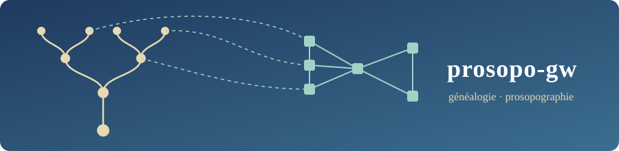
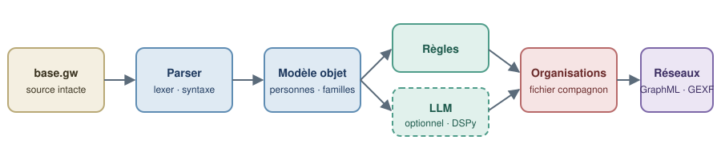

<div align="center">



# prosopo-gw

**De la généalogie GeneWeb à la prosopographie : parser fiable, modèle objet, organisations, graphes et enrichissement par LLM.**

[English version → README.en.md](README.en.md)

[](https://github.com/Relais4x100a2/prosopo-gw/actions/workflows/ci.yml)


[](LICENSE)

</div>

---

## En deux minutes

[GeneWeb](https://geneweb.tuxfamily.org/) est un logiciel de généalogie très répandu, dont le format texte natif (`.gw`) sert de pivot à de nombreuses bases savantes. Ce format décrit des **familles** et des **personnes**, mais pas ce que les chercheurs veulent souvent étudier : **les institutions, écoles, métiers, associations** auxquelles ces personnes ont appartenu. Ces informations existent bel et bien dans les bases, mais cachées dans des événements personnalisés saisis librement (`#Membre_1900`, `#Cours_peinture`, `#Action-Sociale`…).

prosopo-gw s'attaque à ce problème en trois temps :

1. **Lire** un fichier `.gw` sans rien perdre, avec un parser testé sur des cas limites (apostrophes, calendriers multiples, dates approximatives, extensions GW Plus, encodages).
2. **Modéliser** : en plus de `Person`, `Family` et `Event`, une entité **`Organization`** reliée aux personnes par des liens datés. Le fichier `.gw` n'est jamais modifié ; les organisations vivent dans un fichier compagnon JSON.
3. **Découvrir** les organisations cachées dans les événements libres, d'abord par des **règles déterministes** auditables, puis avec l'aide d'un **LLM** que l'on peut optimiser (DSPy) et valider humainement.


<p align="center"><br><em>Illustrations originales du dépôt, dédiées au domaine public (CC0).</em></p>

```
                ┌───────────────────────────────────────────────────────┐
  base.gw  ───► │  core / geneweb-py                                    │
                │  lexer → syntaxe → modèles → validation               │
                │      │                                                │
                │      ├─► formats/   GEDCOM · JSON · XML · sidecar org │
                │      ├─► api/       REST FastAPI (sessions éphémères) │
                │      ├─► cli/       geneweb-py parse | export         │
                │      └─► analytics/ graphes (NetworkX, GraphML, GEXF) │
                └────────────────────────────┬──────────────────────────┘
                                             │ import
                ┌────────────────────────────▼──────────────────────────┐
                │  app / geneweb-app  (Streamlit + DSPy + OpenRouter)   │
                │  extraction → annotation → prompt → optimisation      │
                │  → validation → transformation de masse → dashboard   │
                └───────────────────────────────────────────────────────┘
```

## Le problème de recherche et l'approche

Un événement personnel dans un `.gw` ressemble à ceci (fixture synthétique) :

```
pevt DUPONT Jean
#birt 1870 #p Lyon                       ← événement standard, déjà exploitable
#occu 1895 #p [Atelier_Rose]_-_Lyon      ← lieu avec complément : « Atelier Rose » à Lyon
#Cours_peinture ~1890                    ← texte libre : une école ? un atelier ?
#Membre_1900 1900                        ← appartenance à quelque chose
#Action-Sociale 1905 #s Archives         ← une association ?
end pevt
```

Les événements standards (`#birt`, `#deat`…) sont déjà bien structurés. Les autres sont du **texte libre** : on ne peut pas les interroger, les compter ni les relier entre personnes. L'approche de prosopo-gw est volontairement **à étages**, du moins coûteux au plus incertain :

| Étage | Mécanisme | Pourquoi |
|---|---|---|
| 1. Règles | `EventToOrganizationMapper` : préfixes de rôle (`Membre`, `Élève`, `Employé`, `Soldat`…) et lieux « `[Complément]_-_Ville` » → proposition d'organisation avec un **score de confiance**. Ordre de priorité : complément de lieu contenant un mot d'établissement > tag (s'il dit plus qu'un rôle) > « à déterminer » (le complément sert de nom) | Déterministe, rapide, gratuit, explicable, reproductible |
| 2. LLM (optionnel) | Un hook branchable arbitre les cas sans signal. Les prompts sont **annotés puis optimisés avec DSPy** à partir d'exemples étiquetés à la main | N'intervient que là où les règles échouent ; ne remplace pas la décision humaine |
| 3. Humain | Pages de validation de l'application avant toute transformation de masse | Une base prosopographique ne tolère pas les inventions silencieuses |

Le résultat est stocké dans un **fichier compagnon `base.org.json`** (organisations + liens personne↔organisation, avec périodes), ce qui garde la source `.gw` intacte et le travail **réversible**.

## Structure du dépôt

```
prosopo-gw/
├── core/                      Paquet `geneweb-py` : le moteur (bibliothèque + API + CLI)
│   ├── src/geneweb_py/
│   │   ├── parser/            lexical → syntax → gw_parser (+ multipass, streaming)
│   │   ├── core/              Date, Person, Family, Event, Place, Organization, expériences proches, Genealogy, validation
│   │   ├── formats/           GEDCOM, JSON, XML, fichier compagnon d'organisations
│   │   ├── api/               FastAPI : sessions, persons, families, events, genealogy
│   │   ├── cli/               binaire `geneweb-py` (Click + Rich)
│   │   └── analytics/         réseaux (extra facultatif)
│   ├── tests/                 1245 tests ; fixtures `.gw` strictement synthétiques
│   └── doc/                   architecture, performances, feuille de route
├── app/                       Application d'enrichissement (Streamlit / DSPy / OpenRouter)
│   ├── docker/geneweb-app/    paquet `geneweb-app` : pages Streamlit + `src/`
│   ├── docker/geneweb-server/ serveur GeneWeb OCaml (implémentation de référence, en conteneur)
│   └── docker-compose.yml
├── run_app.sh                 lance l'application en une commande
├── pyproject.toml · uv.lock   workspace uv (membres : core, app/docker/geneweb-app)
└── .github/workflows/ci.yml   lint, types, tests 3.11 → 3.13, build Docker
```

### Module `core` : le moteur

Le flux de données, de bout en bout :

```
.gw → lexical.py (tokens) → syntax.py (nœuds) → gw_parser.py [+ MultiPassParser] → Genealogy
    → formats/ (GEDCOM · JSON · XML)   ou   api/ (REST, par session)   ou   cli/
```

- **Parser** : tokenisation à cache LRU, puis analyse syntaxique, puis construction des modèles. Un mode **streaming** s'active au-delà de 10 Mo (environ 80 % de mémoire en moins) ; un mode **multi-passes** résout les références croisées (familles, témoins) sur les bases complexes. Ils se combinent.
- **Modèles** : dataclasses pour `Date` (multi-calendriers, préfixes `~ ? < >`, intervalles), `Person`, `Family`, `Event`, `Place`, `Organization`, regroupées dans `Genealogy`.
- **Validation** : mode *strict* (s'arrête à la première erreur) ou *gracieux* (collecte toutes les erreurs avec ligne, token et suggestion).
- **Formats** : export GEDCOM, JSON, XML ; fichier compagnon `.org.json` et CSV des organisations candidates, produits par la bibliothèque (`formats.org_sidecar`) et par l'onglet Export de la webapp (l'export JSON ne le contient pas).
- **API REST** : FastAPI. Elle repose sur des **sessions éphémères en mémoire** (voir [Choix techniques](#choix-techniques-notables)).
- **CLI** : `geneweb-py parse` et `geneweb-py export`.
- **Analytics** : construit un réseau personnes↔organisations et l'exporte vers NetworkX, GraphML, GEXF (Gephi), vis.js ou Pyvis (HTML).

Détails : [`core/README.md`](core/README.md), [`core/AGENTS.md`](core/AGENTS.md), [`core/doc/`](core/doc/).

### Module `app` : l'atelier d'enrichissement

Application Streamlit qui guide l'enrichissement en sept pages, de l'extraction au tableau de bord :

| Page | Rôle |
|---|---|
| 1. Upload & extraction | Charge un `.gw` et isole les événements personnalisés (`#strng`) |
| 2. Annotation | Étiquetage manuel d'un petit corpus d'exemples |
| 3. Enrichissement de prompt | Construit le prompt à partir des annotations |
| 4. Optimisation DSPy | Optimise automatiquement le prompt sur le corpus annoté |
| 5. Validation | Relecture humaine des transformations proposées |
| 6. Transformation de masse | Applique le traitement validé à toute la base |
| 7. Dashboard | Suivi et indicateurs |

L'application s'appuie sur `geneweb-py` via un adaptateur (`src/gw_adapter.py`) : il n'y a **qu'un seul parser** dans le monorepo. Les modèles LLM passent par [OpenRouter](https://openrouter.ai/) (Claude, GPT, Mistral, Gemini…).

Détails : [`app/README.md`](app/README.md), [`app/doc/`](app/doc/).

## Démarrage rapide

### Prérequis

- [`uv`](https://docs.astral.sh/uv/) (gestionnaire Python utilisé exclusivement ici) : `curl -LsSf https://astral.sh/uv/install.sh | sh`
- Python 3.11+ (uv le télécharge au besoin)
- Docker, seulement si vous voulez la pile conteneurisée
- Une clé OpenRouter, seulement pour les pages LLM de l'application

### 1. Installer

```bash
git clone https://github.com/Relais4x100a2/prosopo-gw.git
cd prosopo-gw
uv sync --all-packages --all-extras
```

### 2. Vérifier que tout fonctionne

```bash
uv run --package geneweb-py python -m pytest core
# attendu : 1245 passed, 17 skipped
```

### 3. Essayer le CLI sur une fixture

```bash
uv run --package geneweb-py geneweb-py parse core/tests/fixtures/sample_tree.gw
```

Vous obtenez un tableau de synthèse (encodage détecté, validité, 9 personnes, 3 familles, 4 liens enfants). Ensuite, exporter :

```bash
uv run --package geneweb-py geneweb-py export core/tests/fixtures/sample_tree.gw --format gedcom -o /tmp/sortie.ged
uv run --package geneweb-py geneweb-py export core/tests/fixtures/sample_tree.gw --format json   -o /tmp/sortie.json
```

### 4. Utiliser la bibliothèque en Python

```python
from geneweb_py import GeneWebParser

parser = GeneWebParser()

# Parser un fichier
genealogy = parser.parse_file("core/tests/fixtures/rich_pevt_wit.gw")
print(len(genealogy.persons), "personnes,", len(genealogy.families), "familles")

# Étage 1 : déduire des organisations depuis un événement libre (règles seules)
text = """encoding: utf-8
gwplus

pevt DUPONT Jean
#Cours_peinture 1890 #p [Atelier_Rose]_-_Lyon
end pevt
"""
g = parser.parse_string(text)
print(g.infer_organizations())            # (1, 1) : 1 organisation, 1 lien
print(g.get_organization("atelier_rose_lyon").name)   # Atelier Rose
```

Pour les très gros fichiers : `GeneWebParser(stream_mode=True, use_multipass=True)`.

### 5. Lancer l'API REST

```bash
cd core && uv run python run_api.py --reload
# documentation interactive : http://127.0.0.1:8000/docs
```

Les données sont servies **par session** : on envoie d'abord le fichier, puis on utilise le jeton renvoyé.

```bash
curl -F "file=@tests/fixtures/sample_tree.gw" http://127.0.0.1:8000/api/v1/sessions/
# → réponse : {"session_token": "...", "expires_at": "...", "stats": {"persons": 9, "families": 3}}
curl -H "X-Session-Token: <jeton>" http://127.0.0.1:8000/api/v1/persons/
```

### 6. Lancer l'application d'enrichissement

```bash
./run_app.sh                       # Streamlit sur http://localhost:8501
```

Dans le panneau latéral, saisissez votre clé OpenRouter (elle n'est jamais écrite dans le code ; pour Docker, voir `app/.env.example`).

Ou en conteneurs, avec le serveur GeneWeb de référence :

```bash
docker compose -f app/docker-compose.yml up -d --build
```

> Toute modification de `core/` impose de reconstruire l'image Docker.

### Valider et enrichir

La webapp de l'API (onglet « Organisations », routes `#/organisations` et `#/organisation/<id>`) comporte deux sections : « Organisations (N) » et « Expériences proches (N) ». La première liste les organisations probables déduites par les règles, avec les personnes reliées. Les actes d'état civil (mariage, naissance, décès, recensement, domicile…) sont écartés d'office et jamais proposés comme organisations. Une organisation probable repose sur un signal fort : un événement typé, un mot d'établissement (confiance 0,8), un complément de lieu ou une adresse (source « Adresse ») ; un tag libre seul, comme `#Philatelie_Locale`, n'en fait plus une. La seconde réunit les personnes qui ont vécu un événement de même nature à la même période, dans la même ville ou avec un mot rare en commun dans leurs notes : c'est une proximité, pas une appartenance. Ces rapprochements ne sont pas enregistrés dans le `.org.json`. L'onglet Export propose trois fichiers pour les organisations : `genealogie.org.json` (`/api/v1/genealogy/export/org-json`), `organisations.csv` (`/export/organizations-csv`) et `liens_organisations.csv` (`/export/organization-links-csv`). Les CSV sont en UTF-8 avec BOM, séparateur `;`, pour s'ouvrir directement dans un tableur ; les libellés y sont en français, la confiance a une virgule décimale et les lignes sont triées par organisation.

Un panneau replié, « Réglages et événements non classés », contient les mots ignorés, le nombre d'actes d'état civil écartés automatiquement et d'événements sans date, et le « Reste à classer » (événements sans organisation). Des mots peuvent être ignorés : un événement personnalisé dont le nom contient l'un d'eux n'est ni proposé ni à classer. La liste est vide par défaut ; elle se règle dans ce panneau (bouton « Ignorer ce mot » du reste à classer), vaut pour les exports et reste mémorisée dans le navigateur.

Les expériences proches s'exportent en `experiences_proches.csv` (onglet Export, ou `GET /api/v1/genealogy/export/shared-experiences-csv`) et sont aussi disponibles en JSON (`GET /api/v1/organizations/shared-experiences`) ; la réponse donne `total` (toutes les expériences, avant le plafond de 500) et `truncated` quand le plafond s'applique. L'onglet Stats a une carte « Expériences proches ». En Python : `find_shared_experiences(genealogy, exclude=frozenset(), ignored_words=frozenset())` dans `geneweb_py.core.shared_experiences`. Conception : [`core/doc/shared_experiences_design.md`](core/doc/shared_experiences_design.md).

Le `.gw` n'est jamais modifié : les candidates sont des propositions, à valider avant toute exploitation. Le résultat validé a vocation à revenir dans un `.org.json` propre, que la bibliothèque relit (`formats.org_sidecar.import_organizations`).

Deux voies de validation (la voie 1 dépend d'un chantier ultérieur, le chantier B : la page Validation de l'application Streamlit ne lit pas encore le `.org.json`, elle n'est donc pas utilisable pour l'instant) :

| Voie | Pour quoi | Méthode |
|---|---|---|
| 1. Application Streamlit du dépôt | Faire arbitrer par un LLM les cas que les règles n'attrapent pas, puis valider | `uv sync --all-packages --all-extras` une fois, puis `./run_app.sh` (http://localhost:8501) ou Docker (section 6). Clé du fournisseur saisie dans le panneau latéral, jamais écrite. |
| 2. Tableur (LibreOffice Calc, Excel, Google Sheets) | Passer en revue et trancher | Ouvrir `liens_organisations.csv`, renseigner un statut (à voir / validé / rejeté) et un nom retenu ; trier par organisation puis par date. |
| 2. OpenRefine | Fusionner les doublons | Importer `organisations.csv`, regrouper les noms (fingerprint, puis n-gram), fusionner, exporter. |
| 2. Gephi | Voir les cercles | Avec `uv sync --extra analytics`, exporter le réseau personnes-organisations en GEXF. |
| 2. GeneWeb | Améliorer la source | Harmoniser les tags et compléter les lieux au format `[Complément]_-_Ville`, puis recharger. Seule voie où le `.gw` change, par l'utilisateur dans son outil. |
| 2. Base légère (Airtable, NocoDB, Baserow) | Valider à plusieurs | Importer `liens_organisations.csv`, une vue par validateur, un champ de statut partagé. |

### Analyse de réseaux

```bash
uv sync --extra analytics          # networkx + pyvis
```

Depuis une `Genealogy`, `build_network(genealogy)` produit un réseau exportable en GraphML ou GEXF (ouvrable dans Gephi), en JSON vis.js ou en HTML Pyvis, avec une projection `co_membership()` (personnes liées par une organisation commune).

## Choix techniques notables

- **Un seul parser, écrit à la main.** Pas de grammaire générée : le format `.gw` a trop de cas particuliers (apostrophes, occurrences `Dupont.1`, blocs `notes-db`, extensions GW Plus) pour qu'une grammaire reste lisible. Lark est présent comme extra expérimental mais n'est **pas** utilisé.
- **Le `.gw` n'est jamais réécrit.** Les organisations vivent dans un fichier compagnon : la source de l'historien reste intacte et le travail réversible.
- **Règles d'abord, LLM ensuite.** Le LLM est un recours, jamais le point de départ : ce qui peut être décidé de façon déterministe l'est, avec un score de confiance.
- **Vie privée par conception.** Les sessions de l'API sont en mémoire, expirent (TTL glissant d'une heure) et ne sont jamais persistées. Les en-têtes de sécurité, le CORS fermé par défaut en production, la limite de taille d'upload (50 Mo) et le *rate limiting* (5 créations de session par heure) complètent le dispositif. Le parser embarque des garde-fous contre les entrées démesurées.
- **Qualité outillée.** ruff, mypy sur l'ensemble de `core`, couverture ≥ 80 %, tests marqués (`unit`, `integration`, `slow`, `security`, `performance`…), CI sur Python 3.11, 3.12 et 3.13.
- **Un workspace `uv`, un seul `uv.lock`.** `core` et `app` se résolvent ensemble ; aucun chemin relatif entre eux.
- **Politique de données stricte.** Aucune donnée généalogique réelle dans ce dépôt : les fixtures sont synthétiques (`DUPONT Jean`, `MARTIN Marie`…).

## Contribuer et vérifier la qualité

```bash
uv run --package geneweb-py ruff check core/src core/tests --ignore E501
uv run --package geneweb-py ruff format --check core/src core/tests
uv run --package geneweb-py mypy core/src/geneweb_py
uv run --package geneweb-py python -m pytest core --cov=geneweb_py
uv lock --check
```

Conventions : messages de commit en anglais au format `type(scope): message` (`feat`, `fix`, `docs`, `test`, `chore`), un sujet par commit, tests verts à chaque étape. **N'ajoutez jamais de vraie donnée généalogique** (`*.gw`, `*.ged` réels, noms de vraies personnes) : voir [`AGENTS.md`](AGENTS.md).

## Feuille de route

- Rattachement des personnes et organisations à des référentiels d'autorité (VIAF, Wikidata).
- Export CSV individus / organisations / événements.

Voir [`core/doc/roadmap.md`](core/doc/roadmap.md).

## Licence

[MIT](LICENSE) © Guillaume Cayeux.

Le format `.gw` est celui du logiciel [GeneWeb](https://geneweb.tuxfamily.org/) ; prosopo-gw est un projet indépendant, non affilié à GeneWeb.
